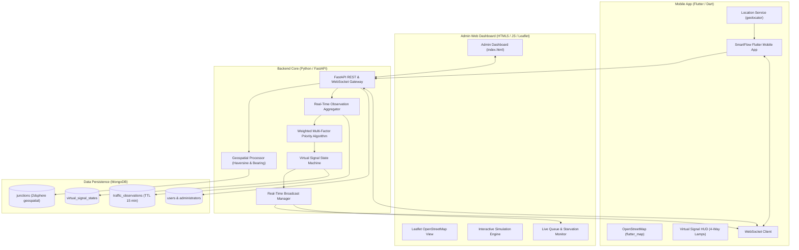

# SmartFlow: AI-Powered Intelligent Traffic Management System

[](https://www.python.org/)
[](https://fastapi.tiangolo.com/)
[](https://www.mongodb.com/)
[](https://flutter.dev/)
[](https://www.openstreetmap.org/)
[]()

> **IMPORTANT SAFETY NOTICE & DISCLAIMER:**
> SmartFlow is an intelligent traffic simulation, research, and virtual advisory system. Virtual signals provided by the backend and mobile applications are strictly informational and intended for connected-vehicle research and simulation. They do **NOT** connect to, control, or override physical public street lights. Participating users must always obey official physical road signals and traffic laws.

---

## 1. Project Overview

**SmartFlow** is a GPS-based intelligent transportation platform designed to alleviate urban traffic congestion at road intersections. 

Instead of relying on rigid, fixed-timer traffic signals that waste green time on empty lanes while queues build up on opposing approaches, SmartFlow uses connected smartphone GPS locations and geofenced detection zones around junctions to:
1. Identify participating vehicles approaching four-way intersections (North, South, East, West).
2. Measure queue length, approach speed, and waiting time.
3. Calculate multi-factor weighted priority scores with anti-starvation fairness rules.
4. Dynamically compute optimal virtual green-phase durations.
5. Distribute real-time virtual signal synchronizations and in-car guidance advisories via WebSockets.

---

## 2. System Architecture



---

## 3. Technology Stack

- **Mobile Application:** Flutter 3.x, Dart, `flutter_map`, `latlong2`, `geolocator`, `web_socket_channel`, `provider`, `http`.
- **Backend Framework:** Python 3.11+, FastAPI, Uvicorn, Pydantic v2, Motor (Async MongoDB driver), PyMongo, PyJWT / Python-Jose.
- **Database:** MongoDB with `2dsphere` geospatial indexing and TTL expiration indexing (includes automatic resilient in-memory fallback for local demos).
- **Mapping & Geofences:** OpenStreetMap vector/raster tile services with Leaflet (web) and `flutter_map` (mobile).
- **Administrator Dashboard:** Standalone single-page web interface (HTML5, modern CSS variables, vanilla JS, Leaflet OpenStreetMap).

---

## 4. Key Functional Modules

### 4.1 GPS & Detection Zone Module (`geo_service.py`)
- **Haversine Distance:** Measures exact spherical distance in meters between user GPS fix and junction center.
- **Compass Bearing & Corridor Assignment:** Determines user azimuth relative to the intersection center to classify them into **North**, **South**, **East**, or **West** approach corridors.
- **Meters Geofence Zones:**
  * **Inner Stop-Line Zone (&lt; 150m):** Queued at the virtual signal stop line.
  * **Mid Zone (150m – 300m):** Deceleration and queue accumulation corridor.
  * **Outer Catchment (300m – 500m):** Approaching inbound vehicle stream.
  * **Out-of-Zone (&gt; 500m):** Automatically de-registered from junction counts.

### 4.2 Intelligent Priority Algorithm (`priority_algorithm.py`)
Computes priority scores for each corridor using a multi-factor weighted equation:

$$S_c = 0.25 \cdot V_c + 0.20 \cdot \rho_c + 0.25 \cdot \bar{W}_c + 0.15 \cdot W_{c,\max} + 0.15 \cdot E_c$$

- **Anti-Starvation Fairness Rule:** If maximum wait time $W_{c,\max} \ge 60\text{s}$, approach $c$ is assigned forced right-of-way, ensuring low-traffic cross streets are never trapped by arterial roads.
- **Emergency Vehicle Preemption:** Ambulances and emergency responders inject an immediate score boost (+300.0) that preempts opposing phases.
- **Dynamic Green Duration:** Green phase times are dynamically scaled between $10\text{s}$ and $55\text{s}$ proportional to the active vs. opposing queue ratio.

### 4.3 Virtual Signal State Machine (`signal_controller.py`)
Maintains a 6-phase conflict-free cycle:
1. `NORTH_SOUTH_GREEN` (Dynamic $10\text{s} - 55\text{s}$)
2. `NORTH_SOUTH_YELLOW` (Clearance $4\text{s}$)
3. `ALL_RED_TRANSITION_1` (Interlock $2\text{s}$)
4. `EAST_WEST_GREEN` (Dynamic $10\text{s} - 55\text{s}$)
5. `EAST_WEST_YELLOW` (Clearance $4\text{s}$)
6. `ALL_RED_TRANSITION_2` (Interlock $2\text{s}$)
- **Early Cutoff:** If active queue drains to zero while opposing lane has waiting vehicles, the green terminates early to eliminate empty-intersection delays.

---

## 5. Directory Structure

```
SalsaRide / SmartFlow/
├── backend/
│   ├── app/
│   │   ├── api/                     # REST API Endpoints (auth, junctions, traffic, signals, simulation)
│   │   ├── core/                    # Security, constants, JWT hashing
│   │   ├── models/                  # MongoDB documents and data schemas
│   │   ├── schemas/                 # Pydantic validation contracts
│   │   ├── services/                # GeoService, TrafficService, PriorityAlgorithm, SignalController
│   │   ├── websockets/              # Real-time WebSocket connection manager
│   │   ├── config.py                # Pydantic Settings
│   │   ├── database.py              # MongoDB Motor connection & In-Memory fallback
│   │   └── main.py                  # FastAPI app entrypoint & background timer loop
│   ├── tests/                       # Pytest test suite (100% passing)
│   ├── requirements.txt
│   ├── init_db.py                   # Database seeding script
│   └── .env.example
├── admin_dashboard/
│   ├── index.html                   # Admin Dashboard UI
│   ├── css/dashboard.css
│   └── js/
│       ├── api.js                   # REST & WebSocket client
│       ├── map.js                   # Leaflet OpenStreetMap controller
│       ├── signals.js               # 4-way traffic light visualizer
│       └── app.js                   # UI event bindings & simulation controls
├── mobile_app/                      # Complete Flutter application
│   ├── pubspec.yaml
│   └── lib/
│       ├── config/app_config.dart
│       ├── models/                  # UserModel, JunctionModel, SignalModel
│       ├── services/                # ApiService, LocationService, WebSocketService
│       ├── providers/               # AuthProvider, JunctionProvider, SignalProvider
│       ├── screens/                 # All 10 required Flutter screens
│       └── main.dart                # App entrypoint & MultiProvider
└── README.md
```

---

## 6. Installation & Quick Start

### 6.1 Backend Setup & Execution

1. **Install Python dependencies:**
   ```bash
   cd backend
   python -m pip install -r requirements.txt
   ```

2. **Run Unit Tests:**
   ```bash
   # From project root:
   $env:PYTHONPATH = "backend"
   python -m pytest backend/tests -v
   ```

3. **Start the FastAPI Server:**
   ```bash
   # From backend/ folder:
   python -m uvicorn app.main:app --host 0.0.0.0 --port 8000 --reload
   ```

4. **Access Endpoints:**
   - **Interactive API Documentation (Swagger):** `http://localhost:8000/docs`
   - **Alternative ReDoc Docs:** `http://localhost:8000/redoc`
   - **Admin Web Dashboard:** `http://localhost:8000/admin/`

---

### 6.2 Admin Dashboard Usage

Open `http://localhost:8000/admin/` in your web browser:
1. **Select Junction:** Choose between Grand Central 42nd St NY, Market St SF, or Galle Road Colombo from the top dropdown.
2. **Interactive Map:** View the 3 geofence rings (500m, 300m, 150m). Click anywhere inside the geofence to spawn a simulated participating commuter.
3. **Simulate Scenarios:**
   - Click **Morning Rush** to simulate heavy North-South arterial inflow.
   - Click **Single-Lane Jam** to test adaptive early-cutoff and detour guidance.
   - Click **Emergency SOS** to test ambulance preemption overriding signals.
4. **Inspect Live Lamps:** Watch the 4-way signal lamps transition between Green, Amber, and Red with live second countdowns.

---

### 6.3 Flutter Mobile Application Setup

1. **Navigate to mobile app directory:**
   ```bash
   cd mobile_app
   flutter pub get
   ```

2. **Run on Emulator / Physical Device:**
   ```bash
   flutter run
   ```

3. **Included Screens:**
   - **Splash Screen:** Animated brand launch.
   - **Login & Register:** JWT authenticated driver onboarding.
   - **Home Screen:** Live GPS fix, nearest junction distance, and current virtual signal preview.
   - **Live Traffic Map:** Interactive OpenStreetMap (`flutter_map`) with geofence rings and junction pins.
   - **Virtual Signal Screen:** 4-way signal head display with live second countdown and in-car guidance advisory.
   - **Traffic Statistics:** Delay reduction metrics (-38.5%), throughput counters, and emissions prevented.
   - **Nearby Junctions:** Geofenced list of intersections with distance indicators.
   - **User Profile & Settings:** Location sharing toggles, custom server URL config, and official safety disclaimers.

---

## 7. REST API Reference

| Method | Endpoint | Description |
| :--- | :--- | :--- |
| `POST` | `/api/v1/auth/register` | Register driver account with hashed password. |
| `POST` | `/api/v1/auth/login` | Authenticate driver and issue JWT access token. |
| `GET` | `/api/v1/junctions` | List all active registered road intersections. |
| `GET` | `/api/v1/junctions/nearby` | Find junctions within radius of coordinates (`lat`, `lon`). |
| `POST` | `/api/v1/traffic/ping` | Ingest user GPS fix, detect corridor, and update participation. |
| `GET` | `/api/v1/traffic/{id}` | Real-time traffic breakdown across North, South, East, West corridors. |
| `GET` | `/api/v1/signals/{id}` | Current virtual signal phase, lamp colors, and countdown timer. |
| `GET` | `/api/v1/signals/{id}/advisory` | Personalized in-car guidance for user's approach corridor. |
| `POST` | `/api/v1/simulation/{id}/inject` | Inject simulated vehicle into specific corridor. |
| `POST` | `/api/v1/simulation/{id}/preset` | Apply traffic preset (`morning_rush`, `bottleneck`, `emergency`). |
| `DELETE` | `/api/v1/simulation/{id}/clear` | Clear all simulated vehicles at intersection. |
| `WS` | `/ws/junctions/{id}` | Real-time bidirectional WebSocket for live signal countdowns. |

---

## 8. License & Safety Notice

This software is developed for academic, simulation, and connected-vehicle research purposes. Always comply with municipal traffic regulations and physical road lights.

